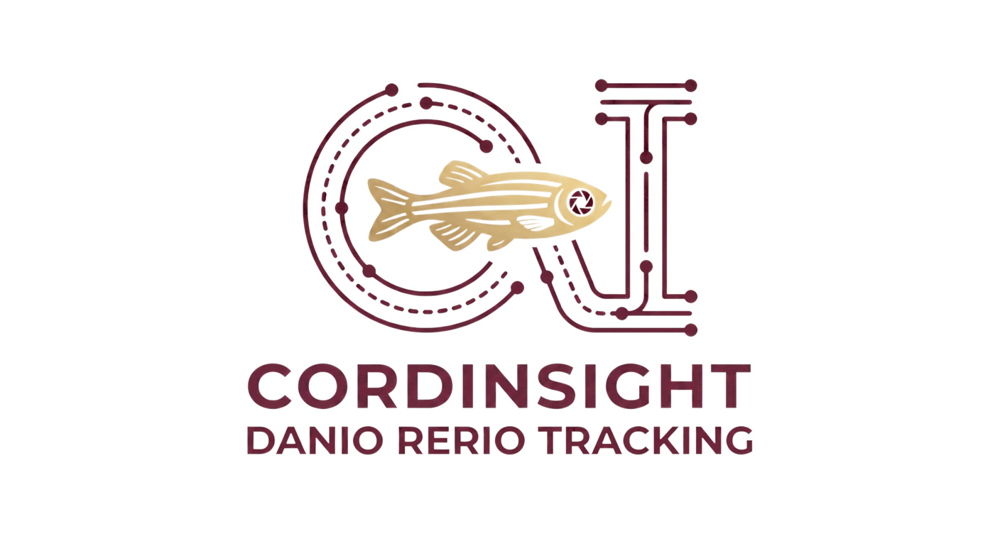

# CordInsight - Zebrafish Behavioral Tracking

<p align="center">
  
</p>

<p align="center">
  <strong>Version 0.0.1</strong>
</p>

A professional behavioral tracking application for analyzing zebrafish (Danio rerio) movement in video footage. Designed for researchers and scientists studying zebrafish behavior in controlled environments.

---

## Overview

CordInsight is a standalone desktop application that enables researchers to:

- Track zebrafish (Danio rerio) movement in recorded video footage
- Define a free-form arena of any shape plus multiple observation zones
- Calibrate to real-world units by entering the real length of one or more of the arena's sides — for distance and speed in cm (mm/m/in)
- Choose exactly which measurements to compute (time/entries per zone, distance, speed)
- Record only a chosen time window of each video (e.g. seconds 30–300) while still tracking the whole clip behind the scenes
- Track automatically with one built-in pipeline — reference (static-background) subtraction that detects the fish whether it moves or not (like EthoVision); nothing to configure
- View a real-time tracking preview at Normal (1x) or Fast speed
- Generate heatmaps showing where the animal spent most time
- Export comprehensive results to Excel for further analysis

The application features a clean, professional light-themed GUI with maroon and gold accents, real-time tracking preview, and sophisticated noise filtering to ensure accurate tracking even in challenging video conditions.

---

## Features

### Core Functionality

| Feature | Description |
|---------|-------------|
| **Video Support** | MP4, AVI, MOV, MKV, WMV, WebM; MTS/M2TS/TS auto-converted via bundled ffmpeg |
| **Single or Batch Mode** | Process one video or multiple videos with the same setup |
| **Arena Definition** | Draw a free-form polygon of any shape for the tracking area |
| **Multiple Zones** | Define unlimited named zones within the arena |
| **Trial Window** | Record only a `[start, end]` slice of each video (in seconds). The whole clip is always tracked behind the scenes — so the model warms up and the window edges stay continuous — but only the window is kept and exported |
| **Calibration** | Enter the real length of one or more arena sides; the app averages them into a uniform cm-per-pixel scale |
| **Measurements** | Tick-box selection of which metrics to compute and export |
| **Real-time Preview** | Watch tracking at **Normal** (real-time) or **Fast** (max speed) — every frame is analyzed either way |
| **Heatmap Generation** | Visualize where the animal spent most time after processing |
| **Excel Export** | Professional formatted reports with aggregated batch data |

### Real-World Measurements (require Calibration)

| Metric | Description |
|--------|-------------|
| **Distance Traveled** | Reconstructed path length, split into direct-detection and inferred segments |
| **Speed** | Path distance ÷ elapsed time between first/last direct detections, maximum interval speed, and a per-frame column |

### Advanced Tracking

| Feature | Description |
|---------|-------------|
| **Automatic Tracking** | One built-in pipeline, nothing to choose: reference (static-background) subtraction (detects a still fish like EthoVision) + persistent contour tracking + offline gap reconstruction |
| **Persistent Tracking** | Follows the same subject without jumping to noise (picks the fish-shaped blob nearest its last position) |
| **Size Filtering** | Configurable Min/Max blob-area bounds reject noise specks and oversized artifacts |
| **Noise Reduction** | Gaussian blur and morphological operations |
| **Two-Pass Reconstruction** | Online detection, then timestamp-based offline reconstruction |
| **Gap Bridging** | Every gap bounded by detections is straight-line interpolated; the fish remains present |
| **Movement Floor** | Configurable pixel threshold suppresses accumulated centroid jitter |
| **VFR-Aware Timing** | Uses real frame timestamps on variable-frame-rate video |

### User Interface

| Feature | Description |
|---------|-------------|
| **Light Professional Theme** | Clean, modern interface with maroon and gold accents |
| **Scrollable Control Panel** | All setup steps in one scrollable sidebar |
| **Frame Picker** | Scrub through video to select reference frame |
| **Visual Zone Editor** | Click-to-draw polygon zones with live preview |
| **Progress Tracking** | Real-time progress bar and frame counter |
| **Dual Preview Panels** | Color tracking view + B/W foreground mask |
| **Live Boundary Overlay** | The auto-detected fish **outline** is drawn on the video each frame (EthoVision-style) and followed continuously — held in place while the fish is briefly still, plus a centroid marker and fading trail |
| **Speed Control** | **Normal** (real-time, watchable) or **Fast** (runs as quickly as the CPU allows); every video frame is still analyzed |
| **Step Gating** | Controls whose prerequisite isn't met yet stay disabled — e.g. "Add Zone" until the arena exists — so the flow reads as one logical step after another instead of failing with a late error |
| **Keyboard Shortcuts** | Quick access to common actions |

---

## System Requirements

| Requirement | Minimum | Recommended |
|-------------|---------|-------------|
| **OS** | Windows 10 (64-bit) | Windows 10/11 (64-bit); also runs on macOS/Linux from source |
| **RAM** | 4 GB | 8 GB or more |
| **Storage** | 200 MB + video space | SSD recommended |
| **Display** | 1280 x 800 | 1920 x 1080 or higher |

---

## The Workflow (Sidebar Steps)

The left sidebar walks through the analysis in order. Calibration and the Trial Window are optional. Fine-tuning knobs live under a collapsible **Advanced** section.

1. **Video & fish** — Browse Video, Pick Frame (and a "Batch mode (multiple videos)" checkbox); optionally **"Select Fish — trace it"** to set the detection size. There is no tracking-method picker — CordInsight uses one automatic pipeline.
2. **Arena** — draw the free-form **Arena**; CordInsight then numbers each side and asks for each side's real length (the calibration)
3. **Zones** — Add Zone, Clear Zones, the zone list, Rename Zone, Delete Zone, Clear All ("Add Zone" stays disabled until the arena is drawn)
4. **Measure** — choose metrics (time per zone, zone entries, distance, speed)
5. **Run** — optional Trial Window (the video's length is shown), Start Processing, progress bar, Export to Excel

> **Advanced (fine-tuning):** hidden by default behind a **"▸ Advanced (fine-tuning)"** toggle — fish size Min/Max (px²), noise filter (blur px), movement floor (px), and **Speed** (Normal/Fast). Each field explains itself with a hover tooltip. Most users never open it.

### Single Video Mode
1. **Launch** the application
2. **Load Video** — Click "Browse Video" and select your file (MTS/M2TS auto-convert), then "Pick Frame" to choose a clear reference frame
3. *(Optional)* **Select Fish** — click **"Select Fish — trace it"** and trace around the fish; CordInsight measures its area and sets the detection size automatically (fine-tune under **Advanced**). There is no method to choose — tracking is automatic.
4. **Draw Arena** — Click "Draw Arena" and click the arena's corners, then finish with a double-click, the Enter key, or clicking back on the green start dot. As soon as it closes, CordInsight numbers each side and opens the **Arena Side Lengths** dialog (see step 5)
5. *(Optional)* **Enter side lengths** — In the **Arena Side Lengths** dialog, type the real length of each side you know (leave the rest blank) and pick a unit; every side you fill in becomes a length reference and they are averaged together. Use **"Edit Dimensions"** later to re-open this dialog without redrawing
6. **Add Zones** — Click "Add Zone", enter a name, then draw each zone
7. **Measurements** — tick which metrics you want (distance/speed need at least one side length entered)
8. *(Optional)* **Trial Window** — in the **Run** step, set "From"/"To" seconds to analyze a slice
9. **Process** — Click "Start Processing" to begin analysis
10. **View Heatmap & Export** — a heatmap appears; click "Export to Excel" to save

### Batch Mode (Multiple Videos)
1. **Enable Batch Mode** — Check "Batch Mode (multiple videos)"
2. **Select Videos** — Click "Browse Videos" and select multiple files
3. **Setup using first video** — Arena, zones, and calibration apply to all videos
4. **Process All** — all videos process sequentially with the same setup
5. **Export** — a single Excel file with aggregated data plus a sheet per video

**Note:** Batch mode assumes all videos share the same camera setup (frame, arena, zones, and calibration).

---

## Calibration

Calibration converts image positions into real-world units so distance and speed are meaningful. It is **optional** — skip it for zone-only analysis. The arena you draw **is** the calibration reference: it is both the tracking area and the source of the scale.

- After you finish drawing the arena (Step 2), CordInsight **numbers each side** on the video (1, 2, 3, …) and pops the **"Arena Side Lengths"** dialog.
- Type the real **length** of each side you know and **leave blank** the ones you don't; a single **unit** selector (mm/cm/m/in) applies to all sides. This generalizes the old rectangle approach — instead of only Width & Height you give the real length of side 1, side 2, side 3, etc. For a trapezoidal novel tank, draw its 4 corners and enter all 4 side lengths (top, bottom, the two slanted sides).
- Every side you fill in becomes a **length reference**. CordInsight converts each to real units per pixel and **averages** them into a single uniform scale, reporting how well they agree (an agreement spread %), so a mistyped length or a non-perpendicular camera shows up. Fill in just one side (e.g. the tank height) for a quick scale, or several for a cross-checked average. Leave every side blank to skip calibration (zone-only: time-in-zone / entries).
- To change the numbers later without redrawing, click **"Edit Dimensions"** (re-opens the side-length dialog for the current arena); to clear calibration, blank every field there and click OK.
- This uniform scale assumes the camera is roughly **perpendicular** ("straight-on") to the plane the fish moves in — the standard setup for the novel tank test and most behavioral assays. Under that assumption the scale (cm per pixel) is uniform across the frame regardless of tank shape, so it works for non-rectangular tanks: the trapezoidal novel-tank-test tank, round dishes, anything.
- There is **no perspective correction**. If footage is filmed at a steep angle, a uniform scale is approximate; true perspective correction would need a known rectangle in the plane, which a trapezoid cannot provide. For best accuracy, film roughly straight-on. Calibration also does not correct lens distortion, refraction through water/glass, or movement toward/away from the camera.

If Distance or Speed is enabled without any side length entered, processing is blocked with a **"Calibration Required"** error telling you to enter at least one arena side's real length (the dialog asks automatically, or use **"Edit Dimensions"**) or untick those measurements.

---

## Fish Size & Detection Settings

Detection size is normally set for you by **"Select Fish"** (Step 1 · Video & fish); the fine-tuning knobs live under the **Advanced** toggle for manual fine-tuning.

### Fish Size (Select Fish)

The simplest way to set the detection size is the **"Select Fish — trace it"** button in **Step 1 · Video & fish**. Pick a frame where the fish is clearly visible, click the button, and trace around the fish by clicking points (finish with a double-click or the Enter key). CordInsight measures the traced silhouette's area and fills the Min/Max detection bounds automatically, then a status line reports the measured size — so you never have to guess pixel values.

### How tracking works (automatic — nothing to choose)

CordInsight uses one built-in pipeline; there is no method picker:

1. **Reference (static-background) subtraction** — it builds an image of the **empty tank** (the per-pixel median across the video, where the moving fish averages out) and detects the fish as whatever **differs from the empty tank**. A fish that holds still **still differs from the empty tank**, so it's detected the whole time — it is not lost when it stops, the way an adaptive model would lose it (this is the EthoVision approach).
2. **Persistent contour selection** — among the blobs that pass the shape/size filters, it picks the one **nearest the fish's last position** (within a max jump), so it follows the same animal and won't hop to a reflection or noise speck.
3. **Two-pass reconstruction** — raw detections + real timestamps are recorded online, then an offline pass bridges any gaps (interpolating between detections on either side) into a continuous track, from which zones and kinematics are derived.

*(Edge case: if the fish parks on the exact same spot for more than about half the whole video, that spot can blend into the background. Rare in a normal assay.)*

### Advanced (fine-tuning)

The fine-tuning knobs are hidden by default behind the **"▸ Advanced (fine-tuning)"** toggle at the bottom of the sidebar. Each field explains itself with a hover tooltip; open it only for manual fine-tuning.

**Fish size (Min/Max area, px²)** — which detected blobs count as the tracked animal.

| Setting | Description | Default |
|---------|-------------|---------|
| **Min** | Reject contours smaller than this (filters noise) | 100 |
| **Max** | Reject contours larger than this (filters shadows) | 50000 |

**Noise filter** — Gaussian blur (px) applied to reduce video noise before detection.

| Value | Effect |
|-------|--------|
| 1 | No blur (use for very clean videos) |
| 3-5 | Light smoothing (recommended for most videos) |
| 7-11 | Moderate smoothing (for noisy videos) |
| 13-15 | Heavy smoothing (for very noisy videos) |

**Movement floor** — the default `2.0 px` floor suppresses small centroid oscillations. Movement is accumulated until it exceeds the floor, so slow sustained swimming is retained instead of discarding every small frame-to-frame step. Set it to `0` to disable this filter.

**Speed** — how the run is paced (never changes accuracy; every frame is analyzed).

| Speed | Description |
|-------|-------------|
| Normal | Paces the scan to real time so the preview plays at ~1x (watchable) |
| Fast *(default)* | Runs as quickly as the CPU allows; the preview redraws occasionally |

### Trial Window

Part of **Step 6 · Run** (the field shows the loaded video's length). Records only part of each video; leave both blank for the whole video. The whole clip is always tracked behind the scenes — so the detector warms up and the window edges stay continuous — but only the window is saved.

- **From (sec)** blank → start at the beginning; e.g. `30` skips the first 30 s.
- **To (sec)** blank → run to the end; e.g. `300` stops at 5 min.
- If the window doesn't fit a video's length, the app warns before running.

### Measurements & Reconstruction

Tick which metrics to compute and export:

- **Time per zone**, **Zone entries** — always available (no calibration needed).
- **Distance traveled**, **Speed (mean & max)** — require calibration.

When the subject cannot be detected:

- Every gap with a real detection before and after is filled with a timestamp-based straight line, regardless of duration. The fish is never classified as absent.
- Leading/trailing frames have only one anchor, so they hold the nearest detected position.
- Leading/trailing holds count toward presence and zone occupancy but not kinematics; their motion is not bounded by two measurements.
- With fewer than two usable detections, kinematics are marked unresolved rather than falsely reporting zero movement; this describes insufficient positional evidence, not an absent fish.

Overlapping zones are supported. A position in an overlap contributes time and entry counts to every containing zone; the frame-data `zone` cell lists those names separated by semicolons.

---

## Keyboard Shortcuts

| Shortcut | Action |
|----------|--------|
| `Ctrl+O` | Open/Browse Video |
| `Ctrl+F` | Pick Frame |
| `Ctrl+D` | Draw Arena |
| `Ctrl+N` | Add New Zone |
| `Ctrl+R` | Start Processing |
| `Ctrl+E` | Export to Excel |
| `Esc` | Cancel Processing |
| `Del` | Clear All Zones |

---

## Excel Output Format

Columns/rows for distance and speed appear only when those measurements are enabled and calibration is set. Zone time/entries appear only when their boxes are ticked.

### Single Video Mode

**Sheet 1: Summary** — Video info; analyzed window; per-frame counts by **status** (Detected / Interpolated / Held / Unresolved), timing/reconstruction metadata, zone results, and calibrated kinematics. The calibration rows report **Scale (`<unit>`/px)**, **Scale lines** (how many arena sides had a length entered), **Scale agreement (%)**, and **Calibration model** = `scale_lines_uniform`. Distance is split into direct-detection and reconstructed segments

**Sheet 2: Frame Data** — Per-frame data: `frame`, `time_s`, `sample_duration_s`, `x`, `y`, `zone`, and `status`. A calibrated run also includes `x_real`/`y_real` (physical coordinates = pixels × scale) and a per-frame `speed`. The `status` column makes every position auditable as a real measurement, an interpolation, or a held value.

**Sheet 3: Zone Statistics** — Per zone: time, percentage, entries (only the enabled columns).

### Batch Mode

**Sheet 1: All Videos Summary** — One row per video with the enabled metrics (including distance/speed when calibrated).

**Sheet 2: Aggregated Zone Stats** — Totals and averages across all videos.

**Sheet 3: All Frame Data** — Combined per-frame data with a video identifier.

**Additional sheets** — Individual frame data for each video.

---

## Troubleshooting

### "Windows protected your PC" (SmartScreen) when opening the .exe

This is **expected** and does **not** mean the app is unsafe. Windows SmartScreen shows this blue warning for any program that isn't signed with a paid code‑signing certificate — it has nothing to do with what CordInsight does. To run it:

1. Click **More info** in the dialog.
2. Click **Run anyway**.

You only need to do this once per downloaded copy. (The only way to remove the warning entirely is to sign the executable with a code‑signing certificate; that is a paid/OSS‑program setup, not something the app itself can change.)

### "Calibration Required" when starting

You enabled Distance or Speed without entering any arena side length. In Step 2 draw the arena and enter at least one side's real length in the "Arena Side Lengths" dialog (it opens automatically, or click "Edit Dimensions") — or untick those measurements in Step 4.

### Tracker jumps between objects

1. Re-run **"Select Fish"** (Step 1) so the detection size matches the animal
2. Increase **Noise filter** to 7-11 (under **Advanced**)
3. Raise **Fish size Min** (under **Advanced**) to filter small noise
4. Ensure only one animal is in the arena
5. Check for reflections or shadows in the video

### Animal not detected

1. Use **"Select Fish"** in Step 1 (Video & fish): trace around the animal on the frame and CordInsight measures its area and sets the detection size automatically (no need to guess pixel values)
2. Decrease **Noise filter** to 1-3 (under **Advanced**)
3. Lower the **Fish size Min** (under **Advanced**, try 50 or lower) if setting it by hand
4. Verify the animal contrasts with the background
5. Try a different reference frame

### Many "Interpolated" or "Held" frames in the output

Detection is dropping the subject often. Re-run **"Select Fish"** or adjust **Fish size** / **Noise filter** under **Advanced**, pick a clearer frame, or improve contrast. The `status` column and the Summary counts show how much of the track was inferred rather than measured.

### Export fails

- Ensure you have write permission to the save location
- Close any open Excel files with the same name
- Try saving to a different location (e.g., Desktop)

---

## Technical Details

### Tracking Algorithm (two-pass)

**Pass 1 — online detection (records raw data only):**
1. **Preprocessing** — Gaussian blur reduces sensor noise
2. **Reference Subtraction** — each frame is compared against the empty-tank background (the per-pixel median across the video); whatever differs is the fish, so a motionless fish stays detected
3. **Morphological Operations** — Opening/closing remove noise
4. **Contour Analysis** — the largest in-arena blob within the Min/Max size bounds is taken as the fish
5. **Association** — Pick the blob closest to the last detected position; the raw centroid (or "not detected") is recorded with the frame's real timestamp

**Pass 2 — offline reconstruction & analysis:**
6. **Gap Bridging** — Using past *and* future, every bounded dropout is interpolated between its real detections. The fish stays present and motion is not compressed into a reacquisition-frame teleport
8. **Zone Detection** — Point-in-polygon on each reconstructed position; outside-zone points remain outside
9. **Kinematics** — Reconstructed path distance, time-weighted speed using one consistent time base
10. **Heatmap Generation** — Duration-weighted 2D histogram, Gaussian blur, then strict arena-polygon masking

### Why two passes?

Online tracking must guess *forward* when the subject disappears, which drifts and "smears" the path on re-acquisition. Because this is offline analysis of a saved file, Pass 2 can look ahead and interpolate between known detections instead — more accurate, and it never loses a subject that was visible before and after the gap.

### Dependencies

| Package | Purpose |
|---------|---------|
| OpenCV | Video processing, image analysis |
| NumPy | Numerical operations, array handling |
| Pandas | Data manipulation, Excel export |
| openpyxl | Excel file writing |
| Pillow | Image display in Tkinter |
| imageio-ffmpeg | Bundled ffmpeg for converting MTS/M2TS and other formats |
| Tkinter | GUI framework (included with Python) |

Install from source with:

```
pip install -r requirements.txt
python cordinsight.py
```

---

## Citing CordInsight

If you use CordInsight in published research, please cite it. The **Cite this repository** button on the [GitHub page](https://github.com/cordinsight/cordinsight) gives APA and BibTeX versions, or you can use:

> Jameel, R., Alhajmee, A., & Strand, K. (2026). *CordInsight: Zebrafish Behavioral Tracking* (Version 0.0.1) [Computer software]. https://github.com/cordinsight/cordinsight

Replace the version with the one you used. It is shown in the app's title bar. Tracking results can differ between versions, so the version is part of what makes your analysis reproducible. The citation details are kept in [CITATION.cff](CITATION.cff).

---

## License

Copyright (C) 2026 Riham Jameel, Ammar Alhajmee, Krys Strand

CordInsight is free software: you can redistribute it and/or modify it under the terms of the **GNU General Public License version 3** (GPL-3.0) as published by the Free Software Foundation. You may use it for any purpose, including commercially; if you distribute it or a modified version, you must make the complete source code available under the same license.

CordInsight is distributed in the hope that it will be useful, but WITHOUT ANY WARRANTY; without even the implied warranty of MERCHANTABILITY or FITNESS FOR A PARTICULAR PURPOSE. See the [LICENSE](LICENSE) file for the full terms.

The Windows executable also bundles FFmpeg, which is covered by its own licenses. See [THIRD_PARTY_NOTICES.md](THIRD_PARTY_NOTICES.md).

---

*CordInsight v0.0.1 - Zebrafish Behavioral Tracking Made Simple*
