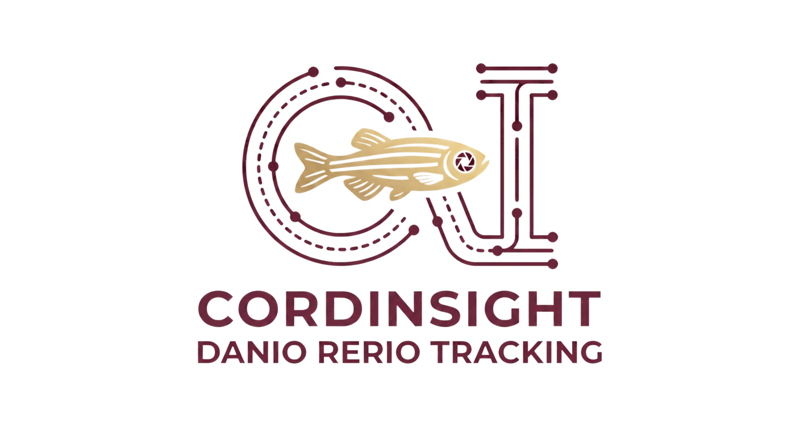

# CordInsight - Development Guide

<p align="center">
  
</p>

<p align="center">
  <strong>Version 0.0.2</strong>
</p>

This guide explains how to set up a development environment, modify the codebase, add features, and build working executables.

---

## Table of Contents

- [Development Environment Setup](#development-environment-setup)
- [Project Structure](#project-structure)
- [Code Architecture](#code-architecture)
- [Making Changes](#making-changes)
- [Adding New Features](#adding-new-features)
- [Testing Your Changes](#testing-your-changes)
- [Building the Executable](#building-the-executable)
- [Common Development Tasks](#common-development-tasks)
- [Troubleshooting](#troubleshooting)
- [Code Style Guidelines](#code-style-guidelines)

---

## Development Environment Setup

### Prerequisites

1. **Python 3.8 or higher**
   - Download from python.org
   - During installation, check "Add Python to PATH"

2. **Code Editor** (recommended)
   - VS Code with Python extension
   - PyCharm

### Initial Setup

```bash
# 1. Navigate to the project directory
cd cordinsight

# 2. Create a virtual environment (recommended)
python -m venv venv

# 3. Activate the virtual environment
venv\Scripts\activate

# 4. Install dependencies
pip install -r requirements.txt

# 5. Install development dependencies
pip install pyinstaller pillow

# 6. Verify installation
python cordinsight.py
```

### IDE Configuration (VS Code)

Create `.vscode/settings.json`:
```json
{
    "python.defaultInterpreterPath": "./venv/Scripts/python.exe",
    "python.linting.enabled": true,
    "python.linting.pylintEnabled": true,
    "python.formatting.provider": "black",
    "editor.formatOnSave": true
}
```

---

## Project Structure

```
cordinsight/
├── cordinsight.py            # Main application (single-file source)
├── requirements.txt         # Python dependencies
├── README.md                # Project overview
├── LICENSE
├── THIRD_PARTY_NOTICES.md   # licenses for the FFmpeg builds bundled in the exe
├── .github/workflows/       # CI: build & release the Windows exe
│   └── build.yml
├── assets/                  # icon + logo images (bundled into the exe)
│   ├── icon.png
│   ├── Logo-CI-Icon.png
│   ├── Logo-CI-Transparent.png
│   └── Logo-CI-WhiteBG.jpeg
├── scripts/                 # build tooling
│   ├── build_exe.py         # PyInstaller build (run from repo root)
│   └── build_windows.bat    # Windows build wrapper
├── docs/                    # documentation
│   ├── DEVELOPMENT.md        # This file
│   ├── User-Guide.md / .pdf / .docx
│   └── Packet.md / .pdf / .docx
└── dist/                    # built executable (generated, git-ignored)
    └── CordInsight.exe
```

### Why Single File?

The entire application is in `cordinsight.py` for simplicity:
- Easy to distribute and modify
- No import path issues
- Simple PyInstaller configuration
- Quick to understand the full codebase

---

## Code Architecture

### Class Overview

```
cordinsight.py
│
├── Configuration
│   ├── APP_NAME, APP_VERSION     # Application metadata
│   └── COLORS                     # UI color theme
│
├── Module-level helpers
│   ├── compute_scale_from_lines()      # average per-side length references -> units-per-pixel + agreement spread
│   ├── compute_scale()                 # reads settings.scale_lines (derived from arena sides) -> uniform scale info
│   ├── calibration_is_complete()       # true once >=1 arena side has a usable length
│   ├── suggest_fish_area_bounds()      # traced fish area (px²) -> Min/Max detection bounds (used by the Select Fish flow)
│   ├── resolve_times()                 # measured monotonic timestamps, else nominal fallback
│   ├── bridge_track_gaps()             # all bounded gaps interpolated; edges held
│   ├── calculate_kinematics()           # direct-anchor-bounded distance/speed
│   ├── zones_for_point()                # all memberships, including overlapping zones
│   └── add_tooltip()                   # attach a hover tooltip to a widget (used by the Advanced fields)
│
├── TrackingSettings (dataclass)   # All tracking parameters
│   ├── tracking_method           # always "refsub" — reference (static-background) subtraction is the only pipeline
│   ├── refsub_threshold, refsub_samples  # reference-subtraction sensitivity + bg sample count
│   ├── min_area, max_area        # Fish size constraints (px² blob area)
│   ├── blur_size                 # Gaussian blur strength (noise filter)
│   ├── processing_speed          # "normal" (real-time preview) | "fast" (max speed)
│   ├── trial_start, trial_end    # Recording window (seconds); whole clip is still scanned
│   ├── scale_lines, calibration_unit  # Scale refs [{p1,p2,length,unit}] derived from arena sides + reporting unit
│   ├── measure_*                 # Which metrics to compute/export
│   └── movement_threshold_px     # Kinematic jitter floor (px)
│
├── VideoTracker                   # Core tracking engine (two-pass)
│   ├── track()                   # Pass 1: online raw detection + timestamps;
│   │                             #   Pass 2: bridge gaps, derive zones/time/kinematics
│   ├── _reference_background()   # Build the empty-tank background (pre-pass)
│   └── _pick_fish_blob()         # Largest in-arena blob, preferring the last position
│
├── ZoneDrawingCanvas (tk.Canvas)  # Interactive arena (numbered sides) / zone editor
│   ├── start_arena_drawing()     # Begin free-form arena definition
│   ├── start_zone_drawing()      # Begin zone definition
│   ├── start_fish_drawing()      # Trace the fish once; on_fish_selected(area) sets size bounds
│   ├── num_arena_sides()         # Number of sides in the finished arena
│   ├── set_arena_side_lengths()  # Store the real length typed for each arena side ('' = unknown) + unit
│   ├── get_arena_side_lengths()  # Return the per-side lengths (aligned to arena edges)
│   ├── get_scale_lines()         # Derive one scale reference per arena side that has a length
│   └── _on_left_click()          # Handle drawing input
│
├── LivePreviewWindow (tk.Toplevel) # Real-time preview
│   ├── update_preview()          # Update display
│   └── set_current_video()       # Update video name display
│
├── HeatmapWindow (tk.Toplevel)    # Heatmap visualization
│   └── _generate_heatmap()       # Create heatmap from tracking data
│
├── UI Widgets
│   ├── ModernButton              # Styled button
│   ├── ModernLabel               # Styled label
│   ├── ModernFrame               # Styled frame
│   └── ModernEntry               # Styled text entry
│
├── CordInsightApp                  # Main application
│   ├── _build_ui()               # Create interface (sidebar steps 1-5 + Advanced)
│   ├── _setup_keyboard_shortcuts() # Bind hotkeys
│   ├── _start_fish_selection()   # Select Fish flow: trace -> suggest_fish_area_bounds() sets size
│   ├── _toggle_advanced()        # Show/hide the collapsible Advanced (fine-tuning) section
│   ├── _refresh_step_gating()    # Disable controls whose prerequisite isn't met (no arena -> no zones)
│   ├── _start_processing()       # Begin video analysis
│   └── _export_results()         # Save to Excel
│
├── FramePickerDialog              # Frame selection dialog
│
├── ZoneNameDialog                 # Zone naming dialog
│
├── SideLengthsDialog              # Prompts for each numbered arena side's real length + a shared unit
│
└── main()                         # Entry point
```

### Data Flow

```
User Input → Video Loading → Frame Selection → Fish Sizing (Select Fish)
                                                                     ↓
                                     Arena Drawing → [Calibration] → Zone Drawing
                                                                     ↓
                                              [Measurements] + [Trial Window]
                                                                     ↓
                                          Pass 1: online raw detection + timestamps
                                                                     ↓
                                          Pass 2: gap bridging → zones / time / kinematics
                                                                     ↓
                          Excel Export ← Heatmap Display ← Results Processing
```

The live preview is driven from Pass 1 (online); all recorded/exported data comes from Pass 2
(offline), which is why a brief dropout never "loses" the subject.

---

## Making Changes

### Step 1: Understand the Change

Before modifying code:
1. Read the relevant class/function docstrings
2. Trace the code flow from user action to result
3. Identify all affected components

### Step 2: Create a Backup

```bash
copy cordinsight.py cordinsight_backup.py
```

### Step 3: Make Your Changes

Edit `cordinsight.py` with your code editor.

### Step 4: Test Incrementally

```bash
# Run after each significant change
python cordinsight.py
```

### Step 5: Test Edge Cases

- Test with different video formats
- Test with various zone configurations
- Test cancel/restart scenarios
- Test with missing/corrupt files

---

## Adding New Features

### Example: Adding a New Tracking Parameter

1. **Add to TrackingSettings dataclass:**
```python
@dataclass
class TrackingSettings:
    # ... existing fields ...
    my_new_param: int = 100  # Add with default value
```

2. **Add UI control in _build_left_panel:**
```python
param_frame = ModernFrame(step3)
param_frame.pack(fill="x", pady=5)
ModernLabel(param_frame, text="My Param:", style="small").pack(side="left")
self.my_param_var = tk.StringVar(value="100")
ModernEntry(param_frame, textvariable=self.my_param_var, width=7).pack(side="left", padx=5)
```

3. **Read the value in _start_processing:**
```python
try:
    self.settings.my_new_param = int(self.my_param_var.get())
except ValueError:
    messagebox.showerror("Invalid Settings", "My Param must be a number.")
    return
```

4. **Use in VideoTracker.track():**
```python
threshold = self.settings.my_new_param
```

### Example: Adding a Keyboard Shortcut

```python
# In _setup_keyboard_shortcuts method
self.root.bind("<Control-x>", lambda e: self._my_new_function())
```

---

## Testing Your Changes

### Manual Testing Checklist

```
□ Application starts without errors
□ Video loading works (MP4, AVI, MOV)
□ Frame picker opens and functions
□ Arena drawing works (all finish methods)
□ Zone drawing works
□ Zone names are saved correctly
□ Processing starts and shows progress
□ Speed control works (Normal / Fast)
□ Live preview displays correctly
□ Processing can be cancelled
□ Heatmap appears after processing
□ Results appear after processing
□ Excel export creates valid file
□ All data in Excel is correct
□ Keyboard shortcuts work
□ Batch mode processes all videos
□ Application closes cleanly
```

### Test Video Recommendations

Create or obtain test videos with:
- Different resolutions (720p, 1080p)
- Different frame rates (24, 30, 60 fps)
- Different durations (short: 10s, long: 5min)
- Clear subject movement
- Various lighting conditions

### Debugging Tips

```python
# Add debug prints
print(f"DEBUG: variable = {variable}")

# Use Python debugger
import pdb; pdb.set_trace()

# Log to file
with open("debug.log", "a") as f:
    f.write(f"{datetime.now()}: {message}\n")
```

---

## Building the Executable

### Quick Build

```bash
# Using the build script
python scripts/build_exe.py

# Or using the batch file
scripts\build_windows.bat
```

### Build Output

```
dist/
└── CordInsight.exe    # Standalone executable (~75 MB)
```

### Build Verification

1. Navigate to `dist/` folder
2. Double-click `CordInsight.exe`
3. Verify all features work
4. Test on a clean machine (no Python installed)

### Build Troubleshooting

**"Module not found" errors:**
```python
# Add hidden import to build_exe.py
"--hidden-import", "missing_module",
```

**Large file size:**
- This is normal for PyInstaller
- The exe includes Python interpreter and all dependencies

**Antivirus warnings:**
- PyInstaller executables sometimes trigger false positives
- Sign the executable with a code signing certificate for distribution

---

## Common Development Tasks

### Changing the Color Theme

```python
# Modify COLORS dictionary
COLORS = {
    "bg_dark": "#f5f6f7",      # Main background
    "bg_medium": "#ffffff",     # Secondary background
    "bg_light": "#f9f2f5",      # Accent background
    "accent": "#6C1D45",        # Primary accent (Maroon)
    "gold": "#EAAA00",          # Secondary accent (Gold)
    "text": "#333F48",          # Main text (Slate)
}
```

### Modifying the Heatmap

```python
# In HeatmapWindow._generate_heatmap()
# Change colormap
heatmap_colored = cv2.applyColorMap(heatmap_normalized, cv2.COLORMAP_INFERNO)

# Adjust blur amount
heatmap = cv2.GaussianBlur(heatmap.astype(np.float32), (51, 51), 0)
```

### Adding Keyboard Shortcuts

```python
# In _setup_keyboard_shortcuts method
self.root.bind("<Control-x>", lambda e: self._my_function())

# Update shortcuts bar in _build_ui
shortcuts_text = "Ctrl+X: My Action | ..."
```

### Modifying Excel Output

```python
# In _write_excel method
def _write_excel(self, path: str):
    with pd.ExcelWriter(path, engine="openpyxl") as writer:
        my_data = pd.DataFrame({"Column": [1, 2, 3]})
        my_data.to_excel(writer, sheet_name="My Sheet", index=False)
```

---

## Troubleshooting

### Application Won't Start

```bash
# Run from command line to see errors
python cordinsight.py

# Check Python version
python --version

# Reinstall dependencies
pip install -r requirements.txt --force-reinstall
```

### Import Errors

```bash
# Ensure virtual environment is activated
venv\Scripts\activate

# Verify package installation
pip list
```

### GUI Not Responding

- Long operations should run in threads
- Use `self.root.after()` for UI updates from threads
- Check for infinite loops in event handlers

### Build Fails

```bash
# Clean previous builds
rmdir /s /q build dist
del CordInsight.spec

# Rebuild
python scripts/build_exe.py
```

---

## Code Style Guidelines

### General Principles

1. **Readability**: Code should be self-documenting
2. **Consistency**: Follow existing patterns
3. **Simplicity**: Prefer simple solutions

### Naming Conventions

```python
# Classes: PascalCase
class VideoTracker:

# Functions/methods: snake_case
def process_frame(self, frame):

# Variables: snake_case
frame_count = 0

# Constants: UPPER_SNAKE_CASE
MAX_FRAME_SIZE = 4096

# Private methods: prefix with underscore
def _internal_helper(self):
```

### Documentation

```python
def complex_function(param1: int, param2: str) -> bool:
    """
    Brief description of what the function does.

    Args:
        param1: Description of first parameter
        param2: Description of second parameter

    Returns:
        Description of return value
    """
    pass
```

### Error Handling

```python
# Good: Specific exception handling
try:
    result = risky_operation()
except FileNotFoundError:
    messagebox.showerror("Error", "File not found")
except PermissionError:
    messagebox.showerror("Error", "Permission denied")

# Avoid: Bare except
try:
    result = risky_operation()
except:  # Don't do this
    pass
```

---

## Version Management

### When to Update Version

Update `APP_VERSION` in `cordinsight.py` when:
- Releasing to users
- Making significant feature additions
- Fixing critical bugs

### Version Format

```
MAJOR.MINOR.PATCH

MAJOR: Breaking changes or major features
MINOR: New features, backward compatible
PATCH: Bug fixes, minor improvements

Examples:
1.0.0 → 1.0.1  (bug fix)
1.0.1 → 1.1.0  (new feature)
1.1.0 → 2.0.0  (major rewrite)
```

---

*Happy Coding!*
