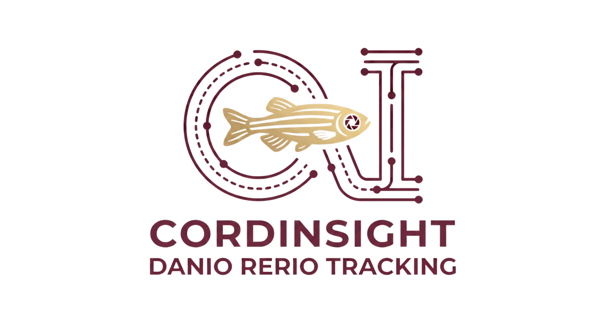

# CordInsight User Guide

<p align="center">
  
</p>

<p align="center">
  <strong>Version 0.0.1</strong><br>
  <em>Zebrafish Behavioral Tracking Made Simple</em>
</p>

---

## Welcome to CordInsight

CordInsight is a Windows desktop application designed to help researchers in undergraduate institutions track and analyze zebrafish (*Danio rerio*) movement in video recordings. Whether you're studying behavioral responses, preference testing, memory, or movement patterns, CordInsight provides an intuitive way to extract meaningful data from your experiments.

**What You'll Learn in This Guide:**
- How to set up your first tracking session
- How to calibrate for real-world distance and speed
- How to choose which measurements to compute
- How to process videos and interpret results

---

## Table of Contents

1. [What is CordInsight?](#1-what-is-cordinsight)
2. [Quick Start Tutorial](#2-quick-start-tutorial)
3. [Understanding the Interface](#3-understanding-the-interface)
4. [Step-by-Step: Your First Analysis](#4-step-by-step-your-first-analysis)
5. [Calibration & Real-World Measurements](#5-calibration--real-world-measurements)
6. [Measurements & Gap Handling](#6-measurements--gap-handling)
7. [Working with Zones](#7-working-with-zones)
8. [Processing Videos](#8-processing-videos)
9. [Understanding Results](#9-understanding-results)
10. [Batch Processing Multiple Videos](#10-batch-processing-multiple-videos)
11. [Keyboard Shortcuts](#11-keyboard-shortcuts)

---

## 1. What is CordInsight?

### Purpose

CordInsight automatically tracks a zebrafish's position in video footage and records:
- **Where** the fish goes (X, Y coordinates)
- **How long** it spends in different areas (zones)
- **How often** it enters each zone
- **How far and how fast** it swims — total distance moved and speed (when calibrated)
- **Movement patterns** visualized as heatmaps

### What You'll Get

After processing a video, CordInsight provides:
1. **Excel spreadsheet** with all tracking data (and a `status` column showing how each position was obtained)
2. **Heatmap image** showing activity distribution
3. **Zone statistics** (time, entries, percentages)
4. **Kinematics** (distance, speed) when calibrated

---

## 2. Quick Start Tutorial

A short overview to get you started. Steps marked *(optional)* can be skipped.

> **First launch on Windows:** once downloaded and trying to install it, if you see a blue **"Windows protected your PC"** SmartScreen box, that is the normal warning for any app not signed with a paid certificate; it does not mean CordInsight is unsafe. Click **More info**, then **Run anyway**. You only do this once per downloaded copy.

### Step 1: Open Your Video
Click **"Browse Video"** and select your video file. 

### Step 2: Pick a Frame & (optional) Trace the Fish
Click **"Pick Frame"** and choose a frame where the arena and fish are clearly visible. *(Optional)* click **"Select Fish — trace it"** and trace around the fish; CordInsight measures its area and sets the detection size automatically. 

### Step 3: Draw the Arena
Click **"Draw Arena"** and click points around your tracking area, then finish with a double-click, the Enter key, or by clicking back on the green start dot. The arena can be any shape.

### Step 4 *(optional)*: Calibrate
Right after you finish the arena, CordInsight numbers each side and opens the **"Arena Side Lengths"** dialog. Insert the real length of each side you know (leave the rest blank) and pick a unit. That powers distance and speed (if you skip it, leave every side blank, you will get in-zone analysis only).

Check "show alignment grid" before moving to the next step to make it easier. 
  
### Step 5: Add Zones
Click **"Add Zone"**, enter a name (e.g., "Left Side"), and draw the zone boundary.

### Step 6 *(optional)*: Trial Window & Measurements
Under Measure, tick the measurements you want, then in Step 5 (Run), set a "From"/"To" window to analyze only part of the video (the field shows the video's length so you don't have to guess), CordInsight always tracks the **whole** clip behind the scenes, so the detector warms up and the window's edges stay continuous, but only the seconds inside your window are kept and exported.

### Step 7: Start Processing
Click **"Start Processing"** and watch the live preview as CordInsight tracks the fish.

### Step 8: Export Results
Click **"Export to Excel"** to save your data.

That's it! You've completed your first analysis.

---

## 3. Understanding the Interface

When you open CordInsight, you'll see two main areas:

```
┌─────────────────────────────────────────────────────────────────┐
│                        CordInsight                                │
├──────────────────┬──────────────────────────────────────────────┤
│                  │                                              │
│  LEFT PANEL      │              MAIN CANVAS                     │
│  (scrollable)    │                                              │
│  1 Video & fish  │     (Shows your video frame                  │
│  2 Arena         │      arena with numbered sides / zones)      │
│  3 Zones         │                                              │
│  4 Measure       │                                              │
│  5 Run           │                                              │
│  ▸ Advanced      │                                              │
│                  │                                              │
├──────────────────┴──────────────────────────────────────────────┤
│  Keyboard Shortcuts: Ctrl+O: Open | Ctrl+F: Frame | ...         │
└─────────────────────────────────────────────────────────────────┘
```

### Left Panel Sections

The panel scrolls; use the mouse wheel if all sections don't fit on screen.

| Section | Purpose |
|---------|---------|
| **1. Video & fish** | Load one video or many (batch), pick a reference frame, and *(optional)* trace the fish with **Select Fish** to set its detection size |
| **2. Arena** | Draw the free-form Arena, then enter its side lengths to calibrate. Optional **"Show alignment grid"** overlays a fine grid (clipped to the arena) to help place zones symmetrically |
| **3. Zones** | Add, rename, delete, and clear zones (disabled until the arena exists) |
| **4. Measure** | Choose which metrics to compute |
| **5. Run** | Optional Trial Window (shows the video's length), then run analysis and export results |
| **▸ Advanced** *(collapsible)* | Fine-tuning knobs; fish size Min/Max, noise filter, movement floor, **Fish is darker/lighter than tank**, and **Speed** (Normal/Fast). Hidden by default. |

CordInsight tracks with **one automatic pipeline**. There is no tracking-method choice to make (see [§4.5](#45-advanced-optional)).

### Main Canvas

- Displays the current video frame
- Shows your arena (cyan outline) and zones (colored areas)
- Interactive drawing area for defining regions

### Status Bar

- Shows keyboard shortcuts for quick access
- Displays current status messages

---

## 4. Step-by-Step: Your First Analysis

Let's walk through a complete analysis session.

### 4.1 Loading a Video

1. Click the **"Browse Video"** button (or press `Ctrl+O`)
2. Navigate to your video file
3. Select the file and click "Open"

**Supported formats:** MP4, AVI, MOV, MKV, WMV, WebM. MTS/M2TS/TS and other camcorder formats are detected and converted to MP4 automatically (a short progress dialog appears).

The first frame of your video will appear on the canvas.

### 4.2 Selecting a Reference Frame & Tracing the Fish

The reference frame is used for drawing your arena and zones, and for tracing the fish to set the detection size, both happen on the same frame. Choose a frame where:
- The arena boundaries are clearly visible
- The lighting represents typical conditions
- The fish is clearly visible

**To select a frame:**

1. Click **"Pick Frame"** (or press `Ctrl+F`)
2. A new window opens with a video scrubber
3. Use the slider to browse through the video
4. Use navigation buttons for fine control (`<<` -100, `<` -10, `>` +10, `>>` +100 frames)
5. When you find a good frame, click **"Select This Frame"**

**To trace the fish (set the detection size):** on that same frame, tell CordInsight how big the subject is so detection is tuned to it. This replaces typing pixel values by hand.

1. With the fish clearly visible, click **"Select Fish — trace it"**
2. Trace around the fish by clicking points along its outline
3. Finish with a **double-click** or the **Enter key**

CordInsight measures the traced silhouette's area and sets the Min/Max detection bounds automatically. The **Fish size** status line updates to show the measured size (e.g. *Size: ~850 px² measured*). You can fine-tune the raw numbers later under **Advanced** (Section 4.5), but most users never need to.

### 4.3 Drawing the Arena

The arena defines the boundary of your tracking area; it can be **any shape**. Only foreground inside it is considered. The arena is also the calibration reference: as soon as you close it, CordInsight numbers each side and asks for their real lengths (see Section 5).

1. Click **"Draw Arena"** (or press `Ctrl+D`)
2. Click on the canvas to add the arena's corners
3. To finish: **double-click**, **press Enter**, or **click back on the green start dot**

The arena appears as a **cyan polygon outline** labelled "Arena", with each side numbered (1, 2, 3, …). The **"Arena Side Lengths"** dialog then opens automatically (Section 5).

### 4.4 Adding Zones

Zones are regions within the arena where you want to measure time spent and entry counts.

1. Click **"Add Zone"** (or press `Ctrl+N`)
2. Enter a descriptive name (e.g., "Left Chamber", "Center", "Near Stimulus")
3. Click **"OK"** and draw the zone polygon (finish the same way as the arena)

Each zone gets a unique color automatically. Repeat for more zones; press `Del` to clear zones and redraw.

**Editing individual zones:** the **Zones** list under the buttons shows every zone. Select one (it highlights on the frame), then click **Rename Zone** to give it a new name or **Delete Zone** to remove just that one; the other zones keep their names and colors. *Clear Zones* still removes them all at once.

### 4.5 Advanced (optional)

The fish size is already set by **Select Fish** (Section 4.2), so most users can skip this. The fine-tuning knobs are hidden behind the **"▸ Advanced (fine-tuning)"** toggle at the bottom of the sidebar; click it to expand. Each field explains itself with a **hover tooltip**, so there is no on-screen paragraph to read. *(There is no tracking-method choice, the automatic pipeline is described below.)*

| Setting | What It Does | Default | When to Adjust |
|---------|--------------|---------|----------------|
| **Fish size Min/Max** | Allowed detected‑blob area, in square pixels (px²) | 100 / 50000 | **Select Fish** fills these; tweak only to fine‑tune by hand |
| **Noise filter** | Blur amount (px) to reduce video noise before detection | 5 | Increase for noisy videos; decrease for a small fish |
| **Movement floor** | Centroid movement (px) ignored as jitter | 2.0 px | Measure stationary‑fish jitter and adjust if needed |
| **Fish is** | Whether the fish is **darker** or **lighter** than the tank | Darker than tank | Set automatically by **Select Fish**. "Darker than tank" ignores bright water reflections/glints — the usual cause of a noisy mask. Switch to "Lighter than tank" only for a pale fish on a dark tank |
| **Speed** | **Normal** plays the preview at real time (watchable); **Fast** runs as quickly as the CPU allows | Fast | Use Normal to watch tracking closely; Fast for batches |

> **Speed.** Either speed analyzes *every* frame. Speed only changes how often the preview redraws and whether the scan is paced to real time. The automatic tracking pipeline runs on the CPU; the status line at the start of a run and the completion dialog both report **"Computed on: CPU (reference subtraction)"**.

## How Tracking Works

**Tracking is fully automatic; there is no tracking method to choose.**

1. **Reference-background subtraction:**

CordInsight first builds a reference image of the **empty tank** by calculating the per-pixel median across the video. Because the fish moves throughout the recording, it largely averages out of this reference image. Each video frame is then compared with the reference, and the fish is detected as the region that **differs from the empty-tank background**.

Detection sensitivity is **automatically calibrated for each video** based on its contrast and noise level. This helps detect faint or low-contrast fish without allowing background noise to dominate the tracking. Among valid detected regions within the arena, the fish is generally identified as the **largest relevant blob**, preventing a small, elongated, or rapidly moving fish from being rejected simply because its apparent shape changes.

CordInsight also accounts for whether the fish appears **darker or lighter than the tank background**. This polarity is set automatically when the fish is identified using **Select Fish**. For example, when tracking a darker fish, the software prioritizes regions that are darker than the reference background while ignoring bright water reflections and surface glare, which are common sources of tracking noise.

To reduce errors caused by changing illumination, each frame's overall brightness is normalized to the reference background before detection. This prevents **lighting or exposure fluctuations**, particularly in backlit recordings, from being mistaken for movement.

If multiple similar regions are detected, for example, the fish and its **reflection in the tank wall**, CordInsight uses the fish selected with **Select Fish** as the initial reference and maintains continuity by favoring the detection closest to the fish's previous position. This reduces sudden switches between the actual fish, reflections, and other artifacts.

Because tracking is based on a **static reference of the empty tank**, a fish remains detectable even when it stops moving: its body still differs from the background. This differs from adaptive background models, which may gradually absorb a stationary fish into the background. In the uncommon case that a fish remains in almost exactly the same location for more than roughly half of the recording, that location may become partially incorporated into the median reference.

2. **Persistent contour selection:**

After potential fish regions are detected, CordInsight filters them using basic shape and size criteria. When more than one plausible candidate remains, it selects the candidate **closest to the fish's previous position**, within a defined maximum movement distance. This maintains continuity between frames and helps the tracker follow the same animal rather than jumping to a reflection, debris, or transient noise.

Position alone does not determine the tracked object. A candidate must first satisfy the detection and filtering criteria; **positional continuity is then used to resolve ambiguity among plausible candidates**.

3. **Two-pass trajectory reconstruction:**

During the first pass, CordInsight processes the video and records the **raw fish detections together with the actual video timestamps**, producing an initial trajectory.

After processing is complete, a second offline pass examines the full trajectory and repairs **brief gaps in detection**. When valid positions exist immediately before and after a short missing interval, CordInsight interpolates between them to reconstruct a continuous trajectory rather than treating the temporary loss of detection as a break in tracking.

The reconstructed trajectory is then used to calculate behavioral measurements, including **zone occupancy, distance traveled, speed, and other movement-based metrics**.

Movement is accumulated until it exceeds the floor, so slow sustained swimming is retained. Set the floor to `0` to disable jitter suppression.

**For most videos, the defaults work well, and Advanced can stay closed.** Only open it if you notice tracking problems. (Calibration is Section 5; measurements and reconstruction are Section 6.)

### 4.6 Starting the Analysis

1. Click **"Start Processing"** (or press `Ctrl+R`)
2. A live preview window opens showing the color tracking view (left) and the B/W detection mask (right)
3. Watch the progress bar fill up; the **auto-detected fish boundary is outlined on the video each frame** and followed continuously (with a centroid marker and a fading trail). When the fish briefly holds still, the outline is held in place so it keeps following the animal rather than blinking off.

**To cancel:** Click "Cancel Processing" or press `Esc`

### 4.7 Viewing the Heatmap

After processing completes, a **heatmap window** automatically appears.

- **Red/Yellow:** High activity (most time)
- **Green/Cyan:** Moderate activity
- **Blue/Purple:** Low activity

Close the heatmap to continue to export.

### 4.8 Exporting Results

1. Click **"Export to Excel"** (or press `Ctrl+E`)
2. Choose where to save, enter a filename, and click "Save"

---

## 5. Calibration & Real-World Measurements

Calibration converts pixels to real units so CordInsight can report **distance in cm** (or mm/m/in), **speed in cm/s**. It is **optional**, skip it for zone-only analysis. The arena you draw **is** the calibration reference: the same drawn shape is both the tracking area and the source of the scale, set from the real lengths of its sides.

### How to calibrate

1. In Step 2, **draw the arena** (Section 4.3). As soon as it closes, CordInsight numbers each side (1, 2, 3, …) and opens the **"Arena Side Lengths"** dialog.
2. Type the real **length** of each side you know and **leave blank** the ones you don't. A single **Unit** selector (mm/cm/m/in) applies to all sides. For a trapezoidal novel tank, draw its 4 corners and enter all 4 side lengths (top, bottom, the two slanted sides); for a quick scale, just fill in one side (e.g. the tank height).
3. The Step 2 calibration status updates, e.g. **Calibration: 2/4 sides → 0.1042 cm/px, ±2%**. To change the numbers later without redrawing, click **"Edit Dimensions"** to re-open the dialog; to clear calibration, blank every field there and click OK.

Every side you fill in becomes a length reference. CordInsight converts each to real units per pixel and **averages** them into a single uniform scale, reporting how well they agree (an **agreement spread %**), so a mistyped length or a non-perpendicular camera is visible. Leave every side blank to skip calibration.

### Important assumptions

- The uniform scale assumes the camera is roughly **perpendicular** ("straight-on") to the plane the fish moves in, the standard setup for the novel tank test and most behavioral assays. Under that assumption, the scale (cm per pixel) is uniform across the frame regardless of tank shape, so it works for non-rectangular tanks: the trapezoidal novel-tank-test tank, round dishes, anything.
- There is **no perspective correction**. If footage is filmed at a steep angle, a uniform scale is approximate; true perspective correction would need a known rectangle in the plane, which a trapezoid cannot provide. For best accuracy, film roughly straight-on.
- Calibration does not correct depth changes toward/away from the camera, refraction through water/glass, or wide-angle lens distortion.

---

## 6. Measurements & Gap Handling

In **Step 4: Measure**, tick the metrics you want:

| Measurement | Needs calibration? | What it reports |
|-------------|--------------------|-----------------|
| **Time per zone** | No | Seconds spent in each zone |
| **Zone entries** | No | Number of times the subject enters each zone |
| **Distance traveled** | Yes | Reconstructed path length, split into direct and inferred segments |
| **Speed (mean & max)** | Yes | Path distance ÷ elapsed time between the first/last direct detections, plus maximum interval speed and per-frame values |

If you enable a calibration-based metric without calibrating, CordInsight stops and asks you to calibrate (Step 2) or untick it.

### Detection-gap reconstruction

When the fish cannot be detected but is seen before and after, CordInsight keeps it present:

- **Every bounded gap** is filled with timestamp-based straight-line interpolation, regardless of its duration.
- **Leading/trailing misses** hold the nearest detection because only one anchor exists. Held leading/trailing frames count toward presence and zone occupancy, but are excluded from kinematics because they are not bounded by two positional measurements.
- **Fewer than two direct detections** makes kinematics unresolved rather than falsely reporting zero movement. This describes insufficient positional evidence, not an absent fish.

Every frame is labelled **Detected**, **Interpolated**, **Held**, or **Unresolved**. Summary distance is split into direct-detection and reconstructed segments.

---

## 7. Working with Zones

### Zone Design Principles

- Zones cover areas of interest in your experiment
- Zone boundaries are clear and logical
- Zones don't need to cover the entire arena

**Zone tips:**
- Zones CAN overlap; time and entries in an overlapping area count toward every containing zone
- Zone names appear in your Excel output, so use descriptive names
- CordInsight warns you if a zone is mostly outside the arena or overlaps another

---

## 8. Processing Videos

### What Happens During Processing

CordInsight analyzes the video in two passes:

**Pass 1 (as the video plays):** detects the fish in each frame and records the raw position (or "not seen") with the frame's real timestamp.

**Pass 2 (after the pass):** reconstructs every bounded gap with a timestamp-based straight line and computes authoritative zones and kinematics from that unsmoothed trajectory.

### Understanding the Live Preview

**Left Panel (Color View):** original frame, cyan arena, colored zones, a colored circle at the fish position, and a fading movement trail.

**Right Panel (Mask View):** black = background, white = detected foreground, green circle = detected position.

**Use the mask view to diagnose problems:**
- Too much white? Increase Noise Filter
- Fish not white? Decrease Noise Filter or Fish Size Min

### Speed Options

The **Speed** control (Advanced) sets how the run is paced; it never changes tracking accuracy, because every frame is always analyzed.

| Speed | What it does | Use Case |
|-------|--------------|----------|
| **Normal** | Paces the scan to real time so the preview plays at ~1x | Watch tracking closely on a single video |
| **Fast** *(default)* | Runs as quickly as the CPU allows; the preview redraws occasionally so it never slows processing | Batches, or when you just want results |

**Note:** Speed doesn't affect tracking accuracy; all frames are always processed regardless of the setting.

---

## 9. Understanding Results

### Excel File Contents

Distance/speed appear only when calibrated and enabled; zone columns appear only when ticked.

#### Sheet 1: Summary

- Video filename, FPS, total frames, duration
- Analyzed window (From/To)
- **Frame counts by status** (Detected / Interpolated / Held / Unresolved), the time base, and reconstruction method
- Time and entries per zone
- Calibration rows — **Scale (`<unit>`/px)**, **Scale lines** (how many arena sides had a length entered), **Scale agreement (%)**, **Calibration model** (`scale_lines_uniform`), and kinematic totals (when calibrated)

#### Sheet 2: Frame Data

| Column | Description |
|--------|-------------|
| frame | Frame number (absolute in the video) |
| time_s | Time in seconds |
| sample_duration_s | Amount of analyzed time represented by this row |
| x | Horizontal position (pixels) |
| y | Vertical position (pixels) |
| x_real, y_real | Physical coordinates (pixels × scale), in calibrated runs |
| zone | Current zone name (empty if outside zones) |
| status | `detected`, `interpolated`, `held`, or `unresolved` |
| speed | Instantaneous speed (only when Speed is enabled) |

#### Sheet 3: Zone Statistics

| Column | Description |
|--------|-------------|
| Zone | Zone name |
| Time (s) | Total seconds in zone |
| Time (%) | Percentage of analyzed time |
| Entries | Number of times fish entered zone |

### Interpreting the Data

**Time in Zone:** higher = the fish preferred that area.

**Zone Entries:**
- High entries + low time = passed through but didn't stay
- Low entries + high time = stayed once it entered

**Status counts:** lots of *Interpolated*/*Held* frames mean detection was dropping often; then revisit Fish Size / Noise Filter or pick a clearer frame. The numbers based on inferred positions are still reported, but you can see how much was inferred.

### Using the Heatmap

- **Confirms zone results:** hot spots should align with high-time zones
- **Reveals patterns:** shows preferred paths
- **Identifies issues:** scattered hot spots can indicate tracking problems
- Heat is weighted by the time represented by each frame and clipped to the arena after blurring; outside-arena pixels remain blank.

---

## 10. Batch Processing Multiple Videos

When you have multiple videos with the **same experimental setup and encoded pixel dimensions** (same camera, crop, resolution, arena, and zones), use batch mode. Processing is blocked when encoded dimensions differ because one image-coordinate arena geometry cannot safely serve both files.

### Setting Up Batch Mode

1. Check **"Batch Mode (multiple videos)"**
2. Click **"Browse Videos"** and select multiple files (Ctrl/Shift to multi-select)
3. Set up calibration, arena, and zones using the **first video's frame**
4. Click **"Start Processing"**

### How Batch Processing Works

- Videos process one after another with the same setup
- Each video gets its own heatmap
- Results are combined into a single Excel file

### Batch Mode Excel Output

| Sheet | Contents |
|-------|----------|
| All Videos Summary | One row per video with the enabled metrics (incl. distance/speed when calibrated) |
| Aggregated Zone Stats | Totals and averages across all videos |
| All Frame Data | Combined frame data with video identifier |
| [Video name] | Individual frame data per video |

### When to Use Batch Mode

- **Good for batch mode:** same camera setup, crop, encoded dimensions, arena size, and zones.
- **Not suitable:** different resolutions, crops, camera angles, arena sizes, or zone requirements.

---

## 11. Keyboard Shortcuts

| Shortcut | Action |
|----------|--------|
| `Ctrl+O` | Open/Browse Video |
| `Ctrl+F` | Pick Frame |
| `Ctrl+D` | Draw Arena |
| `Ctrl+N` | Add New Zone |
| `Ctrl+R` | Start Processing (Run) |
| `Ctrl+E` | Export to Excel |
| `Esc` | Cancel Processing |
| `Del` | Clear All Zones |

---

*CordInsight v0.0.1 - User Guide*
